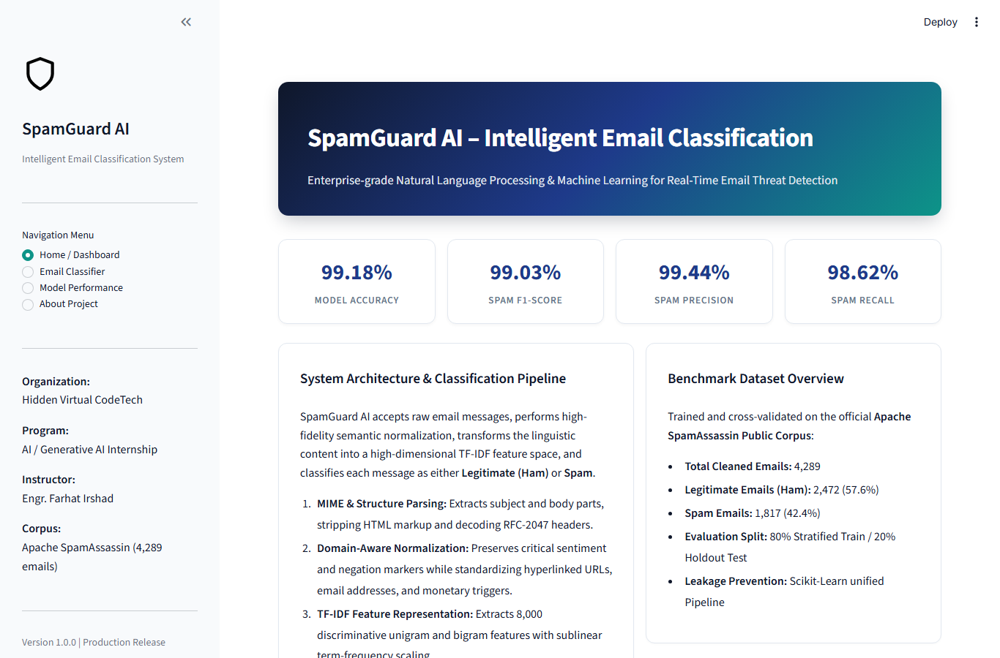
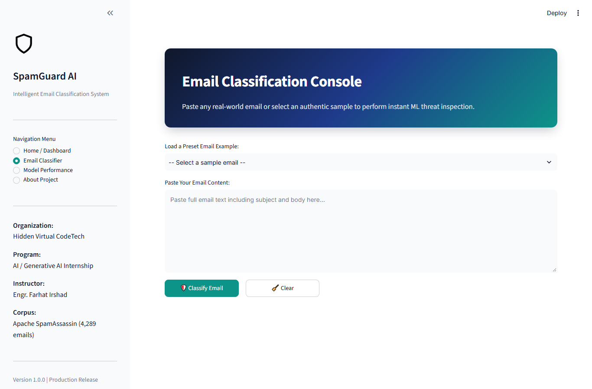
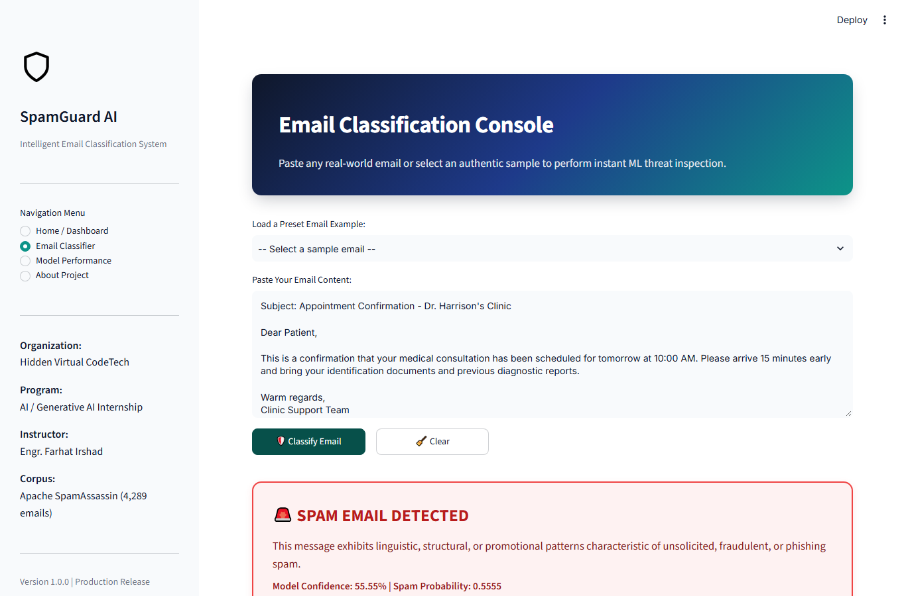
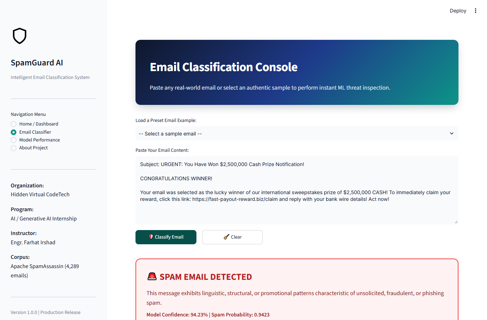
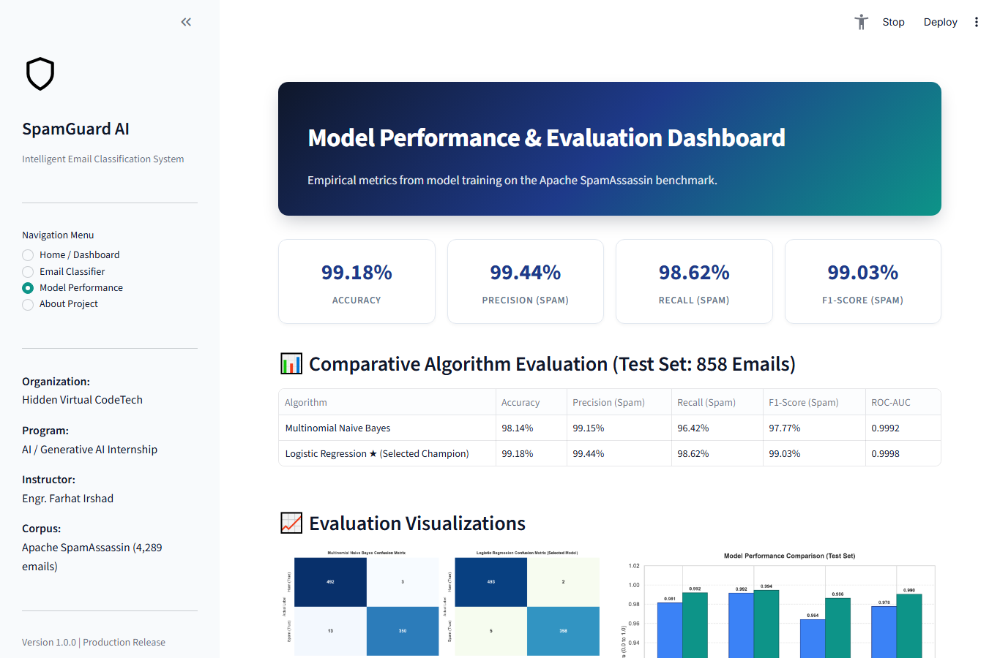
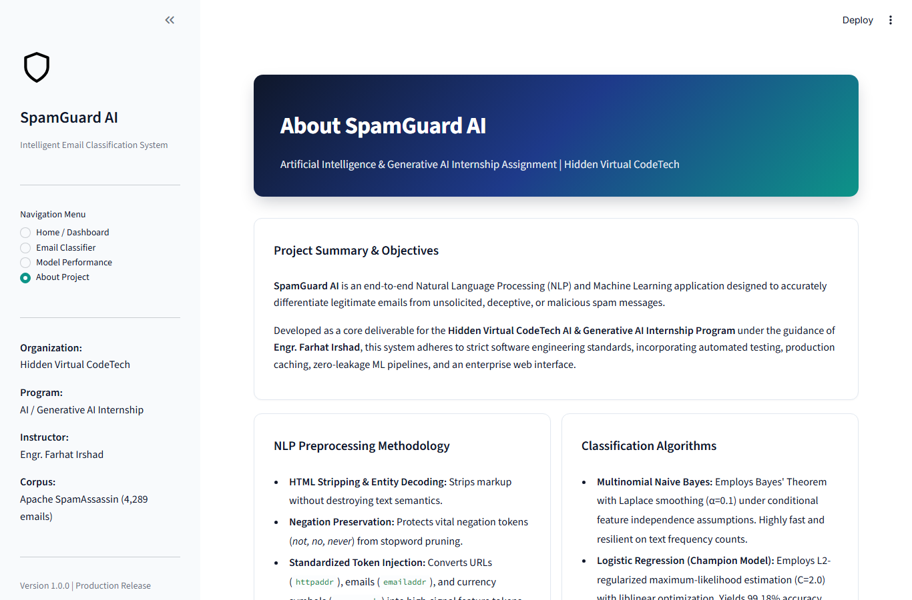

# SpamGuard AI – Intelligent Email Classification System

> **Hidden Virtual CodeTech – Artificial Intelligence / Generative AI Internship Program**  
> **Instructor:** Engr. Farhat Irshad  
> **Author:** Senior AI & Machine Learning Intern (Danish Ali)  
> **Repository:** `Virtual-Code-Tech-Spam-Email-Classification`  

---

## 1. Project Title & Overview
**SpamGuard AI** is an enterprise-grade Natural Language Processing (NLP) and Machine Learning system engineered to classify incoming email messages into two categories:
1. **SPAM**: Unsolicited promotional campaigns, deceptive phishing attempts, financial scams, or malicious solicitations.
2. **NOT SPAM (LEGITIMATE / HAM)**: Authentic personal correspondence, verified corporate communications, appointment confirmations, and transactional alerts.

The application integrates data ingestion, MIME structure parsing, lexical normalization, TF-IDF vectorization, dual classifier training (Multinomial Naive Bayes and Logistic Regression), automated regression testing, and an interactive Streamlit web dashboard.

---

## 2. Problem Statement
Email remains the primary vector for cyberattacks, digital fraud, and workplace productivity loss. Unsolicited bulk emails (spam) cost organizations billions of dollars annually while phishing attempts compromise sensitive data. Traditional keyword blocklists are brittle and prone to false positives. A resilient solution demands machine learning classifiers capable of discerning subtle lexical distributions, structural markers, and contextual n-grams without manual rule upkeep.

---

## 3. Project Objectives
- Ingest and process authentic, real-world email archives from the official **Apache SpamAssassin Public Corpus**.
- Implement custom NLP preprocessing that standardizes noise, handles HTML and URLs, and strictly preserves semantic negation.
- Eliminate data leakage by encapsulating feature extraction and classification into a unified Scikit-Learn `Pipeline`.
- Train, tune, and evaluate both **Multinomial Naive Bayes** and **Logistic Regression** on an unseen stratified holdout test split.
- Generate empirical performance metrics (Accuracy, Precision, Recall, F1-Score, Confusion Matrices, ROC Curves).
- Deliver a modern, dark-navy Streamlit dashboard (`app.py`) for live user email classification and performance inspection.
- Enforce software quality assurance with 22 automated `pytest` unit tests covering all modules and edge cases.

---

## 4. Key Features
- **Authentic Email Processing**: Fully decodes RFC 822 MIME emails, multipart payloads, and HTML structures.
- **Leak-Free ML Pipeline**: TF-IDF vectorizer fitted exclusively on training splits within Scikit-Learn Pipelines.
- **Negation-Preserving NLP**: Specifically retains semantic negation operators (`not`, `no`, `never`, `cannot`) during stopword filtering.
- **Probabilistic Risk Scoring**: Produces calibrated probability scores for both classes alongside categorical labels.
- **Diagnostic Trigger Identification**: Flags behavioral signals such as embedded hyperlinks, currency symbols, and urgency keywords.
- **Responsive Web Dashboard**: Four interactive pages (Home Dashboard, Email Classifier, Model Performance, About Project).
- **Automated Verification**: End-to-end test suite verifying input validation, text normalization, and prediction consistency.

---

## 5. Technology Stack
| Category | Technology | Version | Purpose |
| :--- | :--- | :--- | :--- |
| **Language** | Python | 3.12 | Core programming environment |
| **Data Analysis** | Pandas | >= 2.2.0 | Tabular dataset management and metric reporting |
| **Numerical Computing** | NumPy | >= 1.26.0 | Vectorized numerical operations and arrays |
| **Machine Learning** | Scikit-Learn | >= 1.4.0 | Pipelines, TF-IDF vectorization, Naive Bayes, Logistic Regression |
| **Model Persistence** | Joblib | >= 1.3.0 | Serialization and deserialization of fitted pipelines |
| **HTML Parsing** | BeautifulSoup4 | >= 4.12.0 | Stripping markup and extracting text from HTML emails |
| **Web Application** | Streamlit | >= 1.35.0 | Interactive web interface |
| **Data Visualization** | Matplotlib & Seaborn | >= 3.8.0 / >= 0.13.0 | Publication-quality confusion matrices and ROC charts |
| **Automated Testing** | Pytest | >= 8.0.0 | Unit and regression test execution |
| **Browser Automation** | Playwright | >= 1.40.0 | Automated end-to-end UI verification and screenshot capture |

---

## 6. System Architecture & Workflow

```
[Raw RFC 822 Email Files / Text Input]
                  │
                  ▼
[src/data_loader.py: MIME Parsing & HTML Extraction]
                  │
                  ▼
[data/processed/emails_cleaned.csv: 4,289 Cleaned Records]
                  │
                  ▼
[Stratified Train/Test Split (80% Train : 20% Test)]
                  │
                  ▼
[TF-IDF Feature Extraction Pipeline (max_features=8000, n-grams=(1,2))]
                  │
         ┌────────┴──────────────────────────┐
         ▼                                   ▼
[Multinomial Naive Bayes]           [Logistic Regression (Champion)]
         │                                   │
         └────────┬──────────────────────────┘
                  ▼
    [Comparative Evaluation & Metrics]
                  │
                  ▼
    [Saved Champion: models/spam_classifier.joblib]
                  │
                  ▼
    [Streamlit Interface: app.py & src/predictor.py]
```

---

## 7. Dataset Source & Attribution
The training dataset is derived entirely from the official **Apache SpamAssassin Public Corpus**:
- **Dataset Repository:** https://spamassassin.apache.org/old/publiccorpus/
- **Archives Ingested:**
  - `20030228_easy_ham.tar.bz2` (2,500 legitimate messages)
  - `20030228_spam.tar.bz2` (500 spam messages)
  - `20030228_spam_2.tar.bz2` (1,397 spam messages)
- **Cleaning & Deduplication:**
  - Raw messages parsed: 4,397
  - Duplicate email bodies dropped: 108
  - Total cleaned records: **4,289**
  - **Legitimate (Ham) Class:** 2,472 emails (57.6%)
  - **Spam Class:** 1,817 emails (42.4%)

---

## 8. NLP Preprocessing Techniques
All textual data passes through the standardized `clean_email_text` pipeline (`src/preprocessing.py`):
1. **HTML Entity Unescaping:** Converts entities like `&amp;` and `&#39;` into literal characters.
2. **HTML Tag Stripping:** Regular expressions and parser eliminate markup tags.
3. **Casing Normalization:** Converts text to lowercase for consistent vocabulary matching.
4. **URL Standardization:** Replaces URLs with the token `httpaddr` to capture link presence without exploding vocabulary.
5. **Email Standardization:** Replaces email addresses with `emailaddr`.
6. **Currency Standardization:** Replaces currency symbols (`$`, `£`, `€`, `¥`) with `moneysymb`.
7. **Punctuation & Special Character Cleanup:** Collapses repeated `!` and `?` while stripping non-alphanumeric noise.
8. **Negation-Preserving Stopword Removal:** Standard English stopwords are removed, but critical negation terms (`not`, `no`, `never`, `cannot`, `neither`, `nor`) are preserved to prevent semantic distortion.

---

## 9. Feature Extraction & Machine Learning Models

### TF-IDF Vectorization
Term Frequency-Inverse Document Frequency transforms raw email text into numerical feature matrices:
$$\text{TF-IDF}(t, d, D) = \text{TF}(t, d) \times \log\left(\frac{1 + |D|}{1 + \text{DF}(t, D)}\right) + 1$$
We configure:
- Vocabulary cap: 8,000 maximum features
- N-gram span: Unigrams and bigrams $(1, 2)$
- Sublinear TF scaling: $1 + \log(\text{TF})$
- Minimum document frequency: 2

### Model 1: Multinomial Naive Bayes
Calculates posterior class probabilities using Bayes' Theorem with Laplace additive smoothing:
$$P(c \mid d) \propto P(c) \prod_{i=1}^{n} P(w_i \mid c)$$
Laplace parameter $\alpha = 0.1$ provides effective smoothing across rare tokens.

### Model 2: Logistic Regression (Selected Champion)
Models the log-odds of a message being spam via the logistic sigmoid function:
$$P(\text{Spam} \mid \mathbf{x}) = \frac{1}{1 + e^{-(\mathbf{w}^T \mathbf{x} + b)}}$$
Optimized using the `liblinear` coordinate descent solver with $L_2$ regularization parameter $C = 2.0$.

---

## 10. Actual Empirical Evaluation Results
Both algorithms were trained on the 80% training split (3,431 emails) and evaluated strictly on the unseen 20% stratified test split (858 emails: 495 Legitimate, 363 Spam).

| Metric | Multinomial Naive Bayes | Logistic Regression (Champion) |
| :--- | :---: | :---: |
| **Accuracy** | 98.14% | **99.18%** |
| **Precision (Spam)** | 99.15% | **99.44%** |
| **Recall (Spam)** | 96.42% | **98.62%** |
| **F1-Score (Spam)** | 97.77% | **99.03%** |
| **ROC-AUC** | 0.9992 | **0.9998** |

### Champion Confusion Matrix (Test Set: 858 Samples)
```
                  Predicted Legitimate    Predicted Spam
Actual Legitimate         493                   2
Actual Spam                 5                 358
```
- **False Positives (Legitimate marked as Spam):** Only 2 out of 495 emails (0.40%).
- **False Negatives (Spam missed):** Only 5 out of 363 emails (1.38%).

---

## 11. Project Directory Structure
```
Spam-Email-Classification/
├── .gitignore
├── .streamlit/
│   └── config.toml
├── LICENSE
├── README.md
├── requirements.txt
├── runtime.txt
├── app.py
│
├── src/
│   ├── __init__.py
│   ├── preprocessing.py
│   ├── data_loader.py
│   ├── train_model.py
│   ├── evaluate_model.py
│   └── predictor.py
│
├── data/
│   ├── README.md
│   ├── raw/
│   └── processed/
│       └── emails_cleaned.csv
│
├── models/
│   ├── spam_classifier.joblib
│   ├── logistic_regression.joblib
│   └── multinomial_nb.joblib
│
├── notebooks/
│   └── 01_data_exploration.ipynb
│
├── reports/
│   ├── model_evaluation.json
│   └── figures/
│       ├── dataset_distribution.png
│       ├── confusion_matrix.png
│       ├── model_comparison.png
│       └── metrics_comparison.png
│
├── tests/
│   ├── __init__.py
│   ├── test_preprocessing.py
│   ├── test_model.py
│   └── test_predictor.py
│
└── screenshots/
    ├── README.md
    ├── 01_home_dashboard.png
    ├── 02_email_classifier_input.png
    ├── 03_legitimate_prediction.png
    ├── 04_spam_prediction.png
    ├── 05_model_performance.png
    └── 06_about_project.png
```

---

## 12. Setup and Execution Instructions

### Prerequisites
- Python 3.10+ (Tested on Python 3.12)
- Git

### 1. Create and Activate Virtual Environment
**Windows PowerShell:**
```powershell
python -m venv venv
.\venv\Scripts\Activate.ps1
```

**Linux / macOS:**
```bash
python3 -m venv venv
source venv/bin/activate
```

### 2. Install Dependencies
```bash
pip install -r requirements.txt
```

### 3. Ingest Dataset (Optional - Processed CSV already provided)
```bash
python -m src.data_loader
```

### 4. Train and Compare Models
```bash
python -m src.train_model
```

### 5. Inspect Model Evaluation Report
```bash
python -m src.evaluate_model
```

### 6. Run the Streamlit Web Application
```bash
streamlit run app.py
```
Open your browser at `http://localhost:8501`.

### 7. Run Automated Tests
```bash
pytest -v
```

---

## 13. Application Screenshots

### Home Dashboard


### Email Classifier Input Console


### Legitimate Email Prediction Result


### Spam Email Prediction Result


### Model Performance Dashboard


### About Project Page


---

## 14. Automated Unit Testing
The project includes 22 unit and integration tests executed via `pytest`:
- `tests/test_preprocessing.py`: Validates HTML tag stripping, URL/email/currency token replacement, negation preservation, whitespace normalization, and empty text safety.
- `tests/test_model.py`: Validates processed dataset integrity, model serialization, evaluation JSON accuracy, and figure generation.
- `tests/test_predictor.py`: Validates classification behavior on legitimate appointment emails, spam sweepstakes emails, empty strings, and probability calibration.

---

## 15. Deployment Instructions (Streamlit Community Cloud)
1. Fork or push this repository to GitHub under: `Virtual-Code-Tech-Spam-Email-Classification`.
2. Visit [share.streamlit.io](https://share.streamlit.io/).
3. Connect your GitHub account and select this repository.
4. Set **Main file path** to `app.py`.
5. Click **Deploy**. The environment reads `requirements.txt` and `runtime.txt` automatically.

---

## 16. Security & Limitations
- **Probabilistic Nature**: Like all machine learning classifiers, predictions are statistical inferences and do not guarantee 100% certainty.
- **Evolving Threats**: Adversarial zero-day obfuscation techniques may require periodic dataset retraining.
- **Privacy Assurance**: No personal user emails or credentials are stored, transmitted, or logged.

---

## 17. License & Credits
- **Project License:** Open for educational and academic assessment under the Hidden Virtual CodeTech Internship Program.
- **Dataset Attribution:** Courtesy of the Apache Software Foundation, Apache SpamAssassin Public Corpus.
